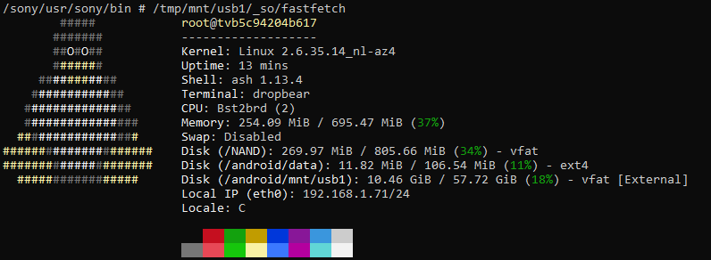

# RB1 platform (2013)
RB1 SW Codename seems to be "Qilin":
```
DTT_BASELINE=//13TV/Qilin/Exp/Release/RB1-Release-11th
```

## SoC
CXD4741GB/CXD4745GB(Ayu2)   
CXD4748GB(Ayu2L)   
"X-Reality Pro"   
- Main ARMv7L Core
- Standby MIPS Core
- Kernel mach: `bst2brd`
- Service manual name: `Ayu2/Ayu2L`   
- Possibly custom by Sony Semiconductor Solutions [ref](https://www.arm.linux.org.uk/developer/machines/list.php?mid=3625)

SYMPTOM
Two versions of main board and tuner board have been used during production.
- BKE/BKT boards (AYU2).
- BLE/BLT boards (AYU2L)

NOTE:
- BKE/BKT (AYU2 processor): With Heat sink.
- BLE/BLT (AYU2L processor): Without Heat sink.

RAM: 1GB DDR3

### Ayu2L
- CPU (CA9(Arm Cortex A9) Dual 800MHz)
- GPU (SGX543)
- Multi-format Dec.

```
Processor	: ARMv7 Processor rev 0 (v7l)
processor	: 0
BogoMIPS	: 1612.80

processor	: 1
BogoMIPS	: 1612.80

Features	: swp half thumb fastmult vfp edsp neon vfpv3 
CPU implementer	: 0x41
CPU architecture: 7
CPU variant	: 0x3
CPU part	: 0xc09
CPU revision	: 0

Hardware	: Bst2brd
Revision	: 0000
Serial		: 0000000000000000
```

## Kernel
`Linux version 2.6.35.14_nl-az4 (root@slave28.jp.sony.com) (gcc version 4.5.1 (20120207 (Sony CE Linux 8.1.0.3)) ) #1 SMP PREEMPT Mon Aug 8 13:28:53 JST 2016` (on `PKG4.600EUA`)
- `-az4` suffix is interesting, this is successor to AZ3 so makes some sense , but should be `rb1`

It seems to come with some custom `snsc_security` system, mostly for protecting the chroot for Android.

## NAND
- 1GB TSOP48 NAND (TC58NVG3S0FTAI0)

The NAND is fully encrypted using a CPU specific key. Therefore even though there are many NAND dumps, they are all useless without access to the actual TV.

For more NAND layout info see `NAND.md`

## UART
The UART connector pinout can be found in service manuals of this or similar platforms (see `common/uart.md`)

The uart is quiet while the TV is running, but if you press `ESC` while powering the TV on, you will get dropped to the bootloader's password prompt:

```
A1949538A_9066794 : Ad7Q2v7V_a_bu0xwIkybb0nq :
```
The first value (`A1949538A_9066794` in my case) is the `serial` value that was also seen in AZ1.   
The second value is a random string that is regenerated on every attempt, example:
```
A1949538A_9066794 : Ad7Q2v7V_a_bu0xwIkybb0nq :
A1949538A_9066794 : X5d3LMYWM1HiMHojFcMOpq :
A1949538A_9066794 : 6E4Isav3DGncZ5HAags0OG :
A1949538A_9066794 : xC4fqbPSo91bDm406dPznq :
A1949538A_9066794 : TLgUeUpPW0WYf7YtFgCT3G :
```
It seems to be built of `0-9`, `a-z`, `A-Z` and `_`.

You have 5 attempts to enter the correct password. If you fail all of them, the system will stall until you reboot.

A unique (per-serial, so per device, and also per attempt) password is generated based on the two provided values. The challenge depends on some call to the hardware crypto processor, so it is not known how it works.

- I got this to appear once after booting in the UART output: 
```
<<< file-system check >>>
FAT floating entry error : FAT[019e] = 019f, FAT[019f] = 01a0, FAT[01a0] = 01a1, FAT[01a1] = fffffff, --> removed
```  
So that means the uart of ABK is also set to display errors.

## Firmware (Update)
See `firmware.md`

## Network Update
The TV requests the firmware update list from https://525c35912b41b9712ecb54a68431bd66.ssm1.internet.sony.tv/DTV/stv/c/STVgetSoftwareVersionList/

With parameters:
- `build`, package version - ex.`PKG4.600EUA`
- `bsp`, BSP version - ex.`BSP-1.1.2-PPP` (hardcoded in dtX2.EU)
- `tv_id`, 5hex selecting the product ID ex.`00008`(check `common/update_platforms.md` for found ones) for `DTV2013` + 32hex unique TV ID. needs to be valid FOR THAT PRODUCT to show the list
- `pkg`, full package release version - ex.`13_RB1_00002100_V1967_PKG4.600EUA_SCFADFV`
- `model`, device model group num - ex.`9`
- `pkg_id`, the package (model) ID - ex.`00002100`

Only `tv_id` is required. By it, you get a XML response like: (08.11.2026)
```xml
<?xml version="1.0" encoding="utf-8"?>
<response sys_ver="7.11/14.0.0">
	<header version="01">
		<command>STVgetSoftwareVersionList</command>
		<code>0</code>
		<debug>
			<process time="0.00468"/>
		</debug>
	</header>
	<sony>
		<product id="DTV2013">
			<list_header version="0">
				<type_of>update</type_of>
				<category_id />
				<option_id />
				<num_recs>0</num_recs>
				<num_ass />
				<list_name>DTV13 Core Production</list_name>
				<group>DTV13 Core Production</group>
			</list_header>
			<updatelist></updatelist>
		</product>
	</sony>
</response>
```
The server is still up, but returns an empty update list, even for a non-updated TV. This leads to the assumption that the update service for these older TVs is no longer avaliable sadly.

Because of this( and because the update enforces HTTPS), I have not investigated the process further. 

## JTAG
JTAG is avaliable on the board, and is set to operate on the STANDBY CPU core (MIPS) by default (possibly changed via strap). 
- `IDCODE 0x447480e3: ver 0x4, part 0x4748 (match CXD4748GB?), mfg 0x071 (Sony)`

Pinout/connection info avaliable in `common/uart.md`

You can interrupt the MIPS's cpu boot operation (described in `boot.md`), but some resources are limited in this state. Also after MIPS boots the ARM core, JTAG is no longer avaliable.

### JTAG limitation
For whatever reason, when JTAG is enabled and we are in the bootrom phase, the NAND controller and some other components become seemingly disabled/unavaliable. The NAND VCC actually drops to 0V. So we currently cannot access NAND while JTAG is engaged.

## Android
The platform has an Android subsystem. Read `android.md`

## GUI
"Genome", introduced with this platform. UI is rendered at 1080p.

## OSS
Listing: https://oss.sony.net/Products/Linux/TV/KDL-55W905A.html   
Kernel: [Sony link](https://prodgpl.blob.core.windows.net/download/TV/common/Lesm5juuv50ygMzqXgF7mg/kernel26.tgz) [Backup](https://s1.theubusu.xyz/0/uploads/sony%20kernels/2013_RB1.tgz)

## SEN/BIVL
Indexes(EU): https://applicast.ga.sony.net/WsIndexes/RB1_EU.xml

The widgets downloaded by the TV are signed. Before laoding a widget, it downloads a `digest.txt` and `digest.sig` file first.

`digest.txt` contains a sha256 digest of files (most important ones, some files are not signed) including the names:
```
Name: info.xml
SHA256-Digest: fQU89f+mPfSOGPzWCzpiLcxnGM50No9e8Ek9mHKZLlo=
Name: canvas.xml
SHA256-Digest: VBEynq7KhCjsr4KCpB+VzfSUmEwc/o+sn1428LDVSNI=
[...]
```
That is signed by `digest.sig`. If its wrong or missing the app will not launch will an error along the lines `This content is unavaliable now.`

I haven't found a way of bypassing this which is pretty sad, the widgets may have some interesting paths for interacting with system.

`SEN_AppList` interfaces with internal API:
```js
var LIST_URL = "http://127.0.0.1:20102/AppDataSource/GetAppList";
var DESC_URL = "http://127.0.0.1:20102/AppDataSource/GetAppDesc";
var STATUS_URL = "http://127.0.0.1:20102/AppDataSource/GetPluginStatuses";
var MSG_URL = "http://127.0.0.1:20102/AppDataSource/SendMsg";
```
This is accessible from inside Android, but not sure if any useful.

### USB Widgets
By creating a `My Widgets` directory on your USB drive and putting widgets there, you can run widgets from USB. A new entry in the Applications section will appear for that purpose. But the widgets still need to be signed.


## PKG (RB1G)
| pkg       | dest | id      |
| --------  | ---------- |---------- |
| EUA       | DVB-AEP-TC_BASE, DVB-AEP-S2_BASE, DVB-AEP-C2_NO-NOR, DVB-AEP-T2_BASE, DVB-AEP-C2_BASE, DVB-AEP-T2_NO-NOR      |sony_dtv0FA30A05A0A5_00002100|
| EUB       | DVB-AEP-T2_MHP, DVB-AEP-C2_MHP   |sony_dtv0FA30A05A0A5_00012100|
| GAA       | DTMB-HK_BASE, DVB-LTN_BASE, DVB-GA-T_BASE, DVB-GA-T2_NO-NU, DVB-TW_BASE, DVB-GA-T2_BASE, DVB-GA-T_NO-NU, DVB-GA-T2_NO-IND      |sony_dtv0FA30A05A0A5_00002201|
| GAB       | DTMB-CN_BASE        |sony_dtv0FA30A05A0A5_00012201 |
| AAA       | ATSC-UC_BASE, ATSC-LTN_BASE      |sony_dtv0FA30A05A0A5_00002301|
| BRA       | ISDB-LTN_BASE       |sony_dtv0FA30A05A0A5_00002400 |
| BRB       | ISDB-LTN_NO-GIN     |sony_dtv0FA30A05A0A5_00012400 |
| JPA       | ISDB-JP_BASE        |sony_dtv0FA30A05A0A5_00002500|

## Logging
### Application log
The TV's various applications and services have a custom logging setup using `/dev/dtlog`. To read these logs (which can be very useful), you can use the tool at `tool/dtlog.c`.

There is a handy binary included on the TV to change the debug level:
```
/sony/usr/sony/bin # dtdebugctrl
Usage: dtdebugctrl [-OPTION] [PARAM] ...

  -c         print status or set color flag on/off/DOMAIN
             $dtdebugctrl -c [off|DOMAIN]
  -l         set debug level by 0-5
             0:NONE,1:ERROR,2:WARNING,3:INFO,4:DETAIL(DETAIL1),5:VERBOSE(DETAIL2)
             $dtdebugctrl -l {0|1|2|3|4|5}
             $dtdebugctrl -l DOMAIN {0|1|2|3|4|5}
             $dtdebugctrl -l DOMAIN CATEGORY {0|1|2|3|4|5}
  -?         print this help
             $dtdebugctrl -?
```

### Kernel log
The kernel console is set to `ttynull` if the `message` environment variable is not set to `on`. If it is set to `on`, it SHOULD print the console to UART. But even though i have seemingly been able to turn it to `on` (dtabk printenv message prints it), The kernel still seemingly doesnt recieve it and prints no logs. It could be a limitiation at ABK level.

## Useful/Misc notes
`info.txt` - output of some commands run from android (build.prop, id, mounts, root, dev, ps, dmesg, cpuinfo)

`release` folder - `.release.version` files from my tv (PKG4.600EUA).

In dmesg:
```
<4>[    1.892078] squashfs: compression name is deflate
<4>[    1.892150] squashfs: crypto module deflate-w12 is used
```
this does not mean that the squashfs is encrypted, they are just using the deflate library of linux `crypto`. This modification is in kernel sources

The opera browser and nginx run as UID 500.
```
  873 500       0:00 nginx
  874 500       0:00 nginx
  1489 500       0:20 dtWebBrowserApp WEBBR
```

## Opera
Version: 3.4.1  
Build: LSDK5603   
Platform: Linux   
System: `armv7l, 2.6.35.14_nl-az4`   
Vega backend: OpenGL ES

### Browser identification
`Opera/9.80 (Linux armv7l; InettvBrowser/2.2 (00014A;SonyDTV115;0002;0100) KDL24W605A; CC/POL) Presto/2.12.362 Version/12.11`
  
### Access paths
Access paths are not displayed

## Sources
KDL-24W605A PKG4.600EUA

##

( ˊᵕˋ )°♡.
