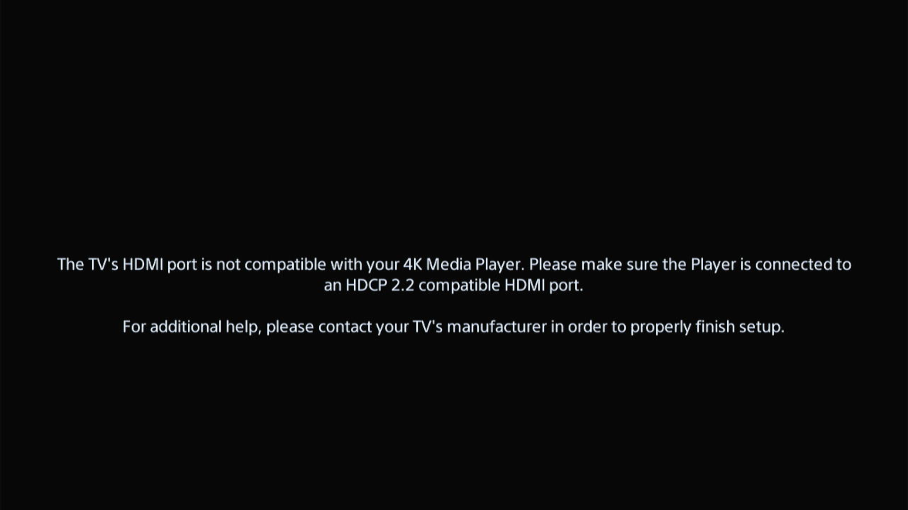
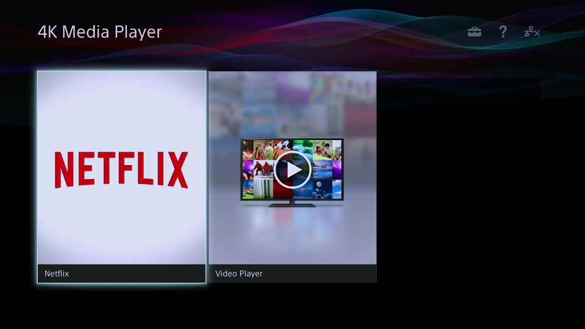
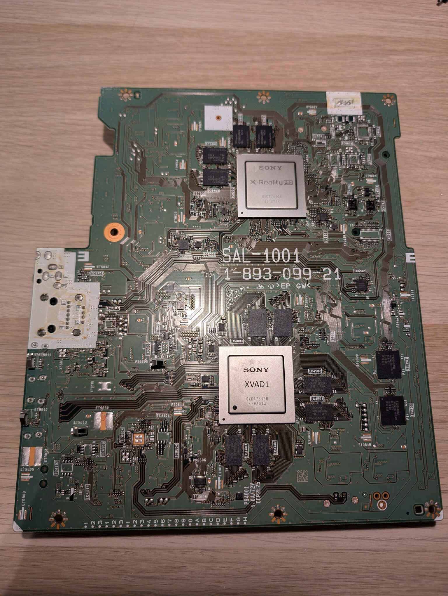
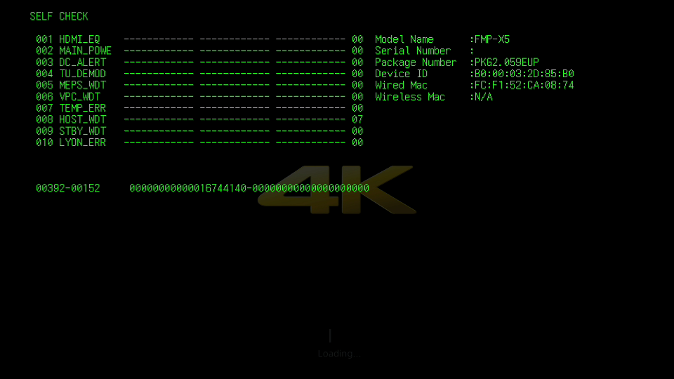
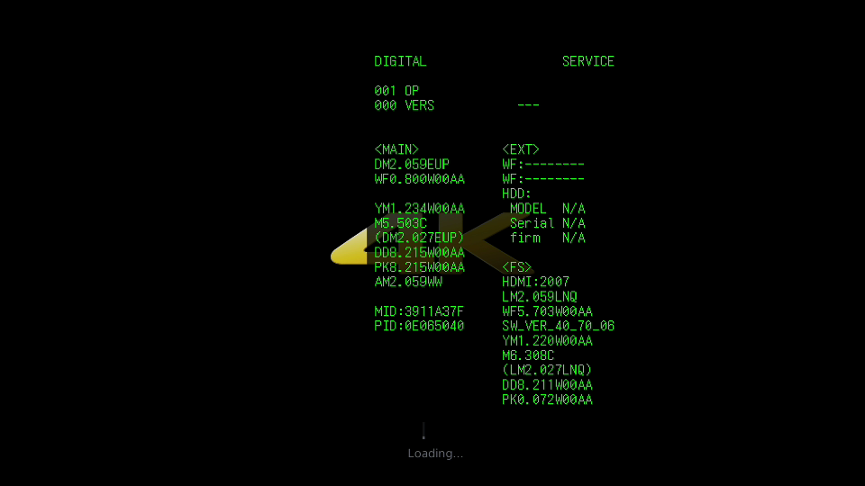

# FMP-X5
Notes for FMP-X5 4K media player, based on RB2 hardware/software. Info should be mostly applicable to all players in series.

## Series comparasion

|               | FMP-X5        | FMP-X7        | FMP-X10       |
|---------------|---------      |---------      |-----------    |
|Destination    |Europe         |Japan          |America        |
|Built-in HDD   |-              |-              |O (1TB)        |
|Tuner          |-              |O              |-              |
|Wi-Fi          |-              |-              |O              |
|Video Player   |O              |O              |O              |
|Music Player   |-              |O              |O              |
|PKG            |`PKG2.059EUP`  |`PKG2.074JPP`  |`PKG2.071AAQ`  |

## HDMI

The player needs to be connected to a HDCP 2.2 compatible HDMI port, otherwise it will not start up. It does not necessarily have to be a Sony TV, it worked on an LG TV, and a 4k DELL monitor.

## Firmware
Since Sony never released a downloadable firmware for this model, I didn't know the update ID. But I was able to guess it quite easily based on the fw of Japanese model, it's `sony_dtv0FA40A08A0A8_00413100`

By using TAR hack and nginx file described in `RB1/firmware.md`, I was able to access some of the internal files, like `/NAND/var/release.pkg.version`:
```
#: [Common Info]
PROTOTYPE=Release
IMAGE_TYPE=ENG-SCFADFLSLFVLV/ENG-SCPADPLSLPVLV
PACKAGE_TYPE=EU
BASELINE_TYPE=P
PACKAGE_PREFIX=14_RB2

#: [PKG Info]
PACKAGE_VERSION=PKG2.059EUP
CORETV_PACKAGE_VERSION=CM2.059EUP
ANDROID_PACKAGE_VERSION=AM2.059WW
DOWNLOAD_ENCRYPTION_MODELID=0x00413100
DOWNLOAD_VERSION=0859
UPDATE_ID=0x0FA40A08A0A8
JP_UPDATE_ID=0xFFFFFFFF
BR_UPDATE_ID=0xFFFFFFFF
DVB_UPDATE_ID=0x00413100
US_UPDATE_ID=0xFFFFFFFF
PACKAGE_NAME=14_RB2_00413100_V0859_PKG2.059EUP_SCFADFLSLFVLV
SYSTEM_PACKAGE_NAME=14_RB2_SYS2.059WW_S.fra
CORETV_PACKAGE_NAME=14_RB2_CM2.059EUP_CF_relnand.fra
ANDROID_PACKAGE_NAME=14_RB2_AM2.059WW_A_user.fra
VERSION_PACKAGE_NAME=14_RB2_00413100_V0859_VER2.059EUP_V.fra
VERSION_BASELINE=//14BOX/Panther/Exp/Release/TypeB-Release-GM10
VERSION_CHANGE_LIST=436883
ANDROID_DATA_PACKAGE_VERSION=AD2.059WW
ANDROID_DATA_PACKAGE_NAME=14_RB2_AD2.059WW_DF_user.fra
LYON_PACKAGE_VERSION=LM2.059LNQ
LYON_PACKAGE_NAME=14_RB2LN_LM2.059LNQ_LF_relnand.fra
LYON_SYSTEM_PACKAGE_NAME=14_RB2LN_SYS2.059WW_S.fra
LYON_VERSION_PACKAGE_NAME=14_RB2LN_00413100_V0859_VER2.059LNQ_V.fra
P4_SYNC_LABEL=@436883
ANDROID_CHANGE_LIST=436874
P4_SYNC_LABEL=@436883
```

But since ngnix runs as UID 500, access to many files is limited. As you can see on the above dump, the latest(?) version for X5 is `PKG2.059EUP`

## Apps

The home screen presents you with only 2 avaliable applications: Netflix and Video player.

Netflix starts to the login screen (seemingly modern version) and promptly crashes a second later.

The Video player runs on Android, and indeed it only allows you to play video files. USB only, no DLNA, also MKV files are not supported for some reason

## Applicast
The player downloads an index from: https://applicast.ga.sony.net/WsIndexes/MB2_WW.xml

It is pretty empty and doesnt have anything useful/interesting. I replaced the index with RB1 and RB2's index, and it started to load the contents, but well no more apps appeared on the homescreen, it is probably hardcoded to only show the 2 apps.

## Hardware

SAL-1001 board. Common for FMP-X5/X7/X10

The player is equipped with Ayu2 (CXD4741GB) and XVAD1 (Lyon, CXD4754GB). The same setup as in high-end RB2 tv.

There is 2xTHGBMAG5A1JBAIR eMMC, for Ayu2 and Lyon.

2Mb SPI-ROM MX25L2006EM1I-12G is used for eMMC boot.

SATA components/connectors are not present for FMP-X5.

There is an unpopulated USB3.0 connector CN4100. Looks to be unused on all variants.

### Notable connections
Not yet tested

|Connector      | FMP-X5        |
|---------------|---------      |
|CN3104         |Located next to SPI flash, has SPI interface "Writing connector at production". HDMI controller related.|
|CN4002         |DEBUG LOG FOR LYON AND FRC|
|CN4004         |MS for Lyon         |
|CN4005         |JTAG for Lyon #1       |
|CN4007         |JTAG for Lyon #2       |
|CN7001         |MS for Ayu2         |
|CN7301         |Main TL-EX1 debug connector with Ayu2 and Lyon console        |
|CN7310         |JTAG for Ayu2|

Lyon has two seperate JTAG connections, labeled "JTAG MIPS/ARM", and "JTAG ALLEGRO"

## Service menus
### Self Check Diagnosis
[RETURN], [DOWN], [PAUSE], [POWER]


### Service Adjustments Mode
[RETURN], [UP], [PAUSE], [POWER]


## Service manual
FMP-X5: https://elektrotanya.com/sony_fmp-x5_fmp-x5-1_4k-hd-mp_ver.1.0_rm.pdf/download.html

FMP-X10: https://elektrotanya.com/sony_fmp-x10_4k-hd-mp_ver.2.0_rm.pdf/download.html