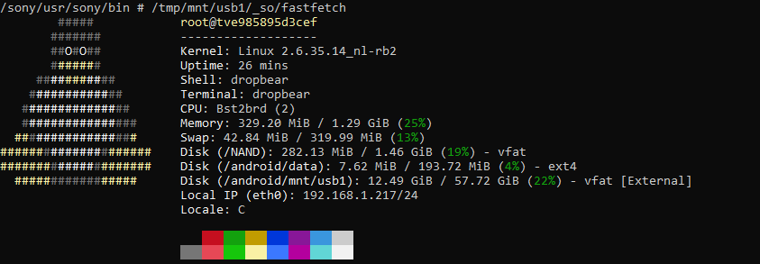

# RB2 platform (2014/2015)

RB2 SW Codename seems to be "Ryu" for TV, and "Panther" for box:
```
DTT_BASELINE=//14TV/Ryu/Exp/Release/RB2-Release-20th
```
```
DTT_BASELINE=//14BOX/Panther/Exp/Release/TypeB-Release-GM14
```


# Most information from RB1 should also apply to RB2.

## SoC
SoC information from RB1 applies, the same are used (Ayu2 on high-end/Ayu2L on mid/lower-end).

For TVs with Ayu2, there is 2GB of RAM. For TVs with Ayu2L, there is 1GB like on RB1.

On high-end 4K TVs and media player, additional "XVAD1" (Lyon, CXD4754GB) SoC is used. Not much is known about it yet

## Kernel
`Linux version 2.6.35.14_nl-rb2 (root@panther-jenkins4) (gcc version 4.5.1 (20120207 (Sony CE Linux 8.1.0.3)) ) #1 SMP PREEMPT Thu Apr 30 22:03:09 JST 2015` (on FMP-X5 `PKG2.059EUP`)

## NAND/eMMC
- 1GB TSOP48 NAND (See RB1's `NAND.md`)
- 4GB eMMC THGBMAG5A1JBAIR (see `emmc.md`) 

eMMC is used on some higher-end models. In both cases, they are fully encrypted.

For models with Lyon, there are 2 eMMC's for each SoC.

### 2Mb SPI-ROM(SerialNorFlash) for eMMC boot
In case of eMMC device, it will boot from an external SPI flash. The flash contains a small 0x1200 encrypted blob, which possiblys sets up the eMMC, and continues the boot from there.

## Android
This platform also has Android 4.0.4 based sub-system like RB1. See its notes for more info

However, Crucial difference: The browser app is missing. So installing APKs that way like in RB1 isnt possible.

To install APKs, you may use the `em_user_hook` method described in RB1's `firmware.md`.

## Firmware (Update)
See RB1's `firmware.md`, RB2 uses the same firmware keys and format, also RB1 tv's can decrypt RB2 fra packages (because keys are SoC specific, and both use same SoC series).

RB2 firmware packages also additionally ship with LYON package for the sub-cpu on some higher-end TVs:
```
LYON_PACKAGE_VERSION=LM3.006LNA
LYON_PACKAGE_NAME=14_RB2LN_LM3.006LNA_LP_relnand.fra
LYON_SYSTEM_PACKAGE_NAME=14_RB2LN_SYS3.006WW_S.fra
LYON_VERSION_PACKAGE_NAME=14_RB2LN_00003100_V1056_VER3.006LNA_V.fra
```

These cannot be decrypted by Ayu2, since Lyon is a seperate soc with different keys.

## GUI
Internally also called „Genome” like in RB1, but its a different full-screen style menu, with panel navigation.

plus DUX (Discovery UX)

## AppliCast
Indexes(EU): https://applicast.ga.sony.net/WsIndexes/RB2_EU.xml

## OSS
Listing: https://oss.sony.net/Products/Linux/TV/KDL-32W705B.html   
Kernel: [Sony link](https://prodgpl.blob.core.windows.net/download/TV/common/xsuUY5l6aneXFxXYkOcoGQ/kernel26.tgz) [Backup](https://s1.theubusu.xyz/0/uploads/sony%20kernels/2014_RB2.tgz)

## PKG (RB2G/RB2T)
| pkg       | dest | id      |
| --------  | ---------- |---------- |
| EUA       | DVB-AEPT2S2_NO-NR, DVB-AEPT2S2_BASE       |sony_dtv0FA40A06A0A6_00003100|
| EUB       | DVB-AEPT2S2_MHP   						|sony_dtv0FA40A06A0A6_00013100|
| GAA       | DTMB-HK_BASE, DVB-TW_BASE, DVB-GAT2_BASE, DVB-GAT2_NO-IND, DVB-GAT2_NO-CI, DVB-LTN_BASE      |sony_dtv0FA40A06A0A6_00003201|
| GAB       | DTMB-CN_BASE        						|sony_dtv0FA40A06A0A6_00013201 |
| AAA       | ATSC-LTN_BASE, ATSC-UC_BASE      			|sony_dtv0FA40A06A0A6_00003301|
| BRA       | ISDB-LTN_BASE       						|sony_dtv0FA40A06A0A6_00003400 |
| BRB       | ISDB-LTN_NO-GIN     						|sony_dtv0FA40A06A0A6_00013400 |
| JPA       | ISDB-JP_BASE        						|sony_dtv0FA40A06A0A6_00003500|

See `common/latest_fw.md` for download

## Opera
Version: 3.5  
Build: LSDK6218   
Platform: Linux   
System: `armv7l, 2.6.35.14_nl-rb2`   
Vega backend: OpenGL ES

### Browser identification
`Opera/9.80 (Linux armv7l; InettvBrowser/2.2 (00014A;SonyDTV140;0001;0001) FMPX5; CC/XAE) Presto/2.12.407 Version/12.50`

### Access paths
Access paths are not displayed

## Notable/Interesting hardware
### FMP-X5/FMP-X7/FMP-X10
See `FMP-X5.md` for more info

These 2014 4K media player models use the Ayu2 CPU and the RB2(based) software. 

FMP-X5(Europe/Canada) never had software update released. [sm](https://elektrotanya.com/sony_fmp-x5_fmp-x5-1_4k-hd-mp_ver.1.0_rm.pdf/download.html)

FMP-X7(Japan) software update site is up at https://www.sony.jp/bravia/update/usbup_fmp-x7.html, `sony_boxupdate_2014_2074_jpp_auth.zip`, `PKG2.074JPP`, update id: `sony_dtv0FA40A08A0A8_00413500`. Original dl link is down, but the file can be found at: https://tv.update.sony.net/OND/2014/as/jp/F93419600_PS108348/sony_boxupdate_2014_2074_jpp_auth.zip. It is pretty much a standard RB2 firmware.

FMP-X10(US) - latest software update `PKG2.071AAQ` released on 04/05/2017, was avaiable [here](https://www.sony.com/electronics/support/home-video-4k-ultra-hd-media-players/fmp-x10/downloads/W0011110), not archived, firmware or even the ID is nowhere to be found now. [sm](https://elektrotanya.com/sony_fmp-x10_4k-hd-mp_ver.2.0_rm.pdf/download.html)

## Notes/Useful
- Level 3 Confidential Service manual for RB2G - contains UART/JTAG pinouts, board schematic and connections of AYU2L(So also useful for RB1) - http://televid-sib.org/index.php?topic=22363.msg148626#msg148626

## Sources
FMP-X5 PKG2.059EUP

##
   
( ˊᵕˋ )°♡.